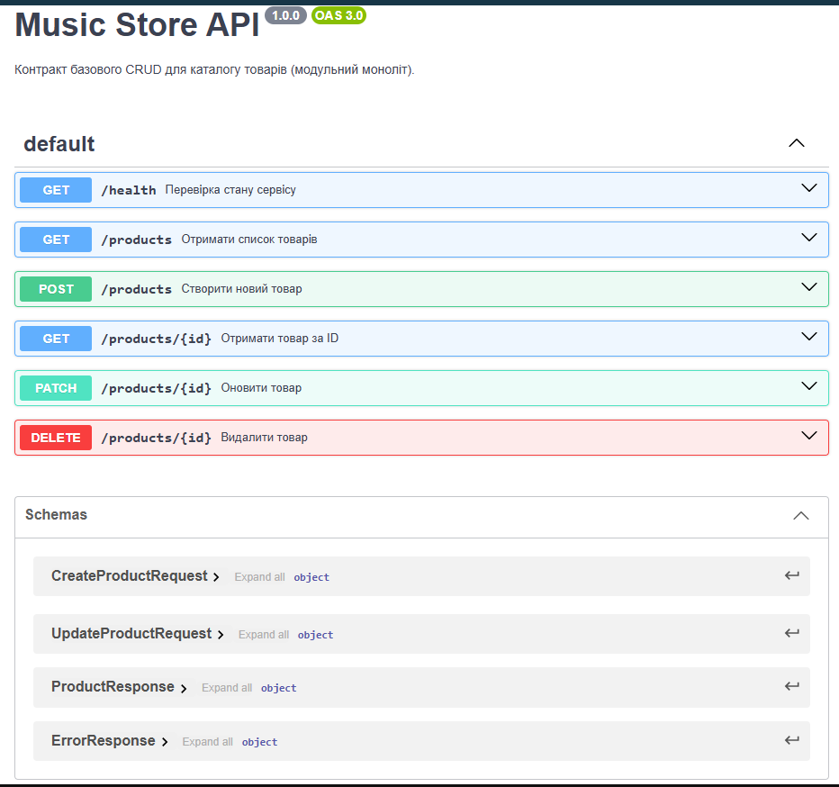

# Music Store


Командний веб-застосунок інтернет-магазину музичних інструментів (Node.js + Express REST API + HTML/CSS/JS Frontend).

---

## Швидкий старт (локально)

### Бекенд
```bash
cd backend
npm install
npm test
npm start
```
Сервер буде доступний на `http://localhost:3000` (перевірка стану: `GET /health`).

### Фронтенд
Відкрити `frontend/index.html` у браузері (або через Live Server / Nginx).

---

## Документація та архітектура (Практичні 2–4)

### Бізнес-аналіз та архітектура (Практична 2)
* Бізнес-документ: [docs/business_doc.md](./docs/business_doc.md)
* План розвитку (Roadmap): [docs/roadmap.md](./docs/roadmap.md)
* Архітектурна діаграма: [docs/architecture_diagram.png](./docs/architecture_diagram.png)

### Domain-Driven Design (Практична 3)
* Сутності та атрибути: [docs/domain/entities.md](./docs/domain/entities.md)
* Глосарій (Ubiquitous Language): [docs/domain/glossary.md](./docs/domain/glossary.md)
* Контекстна карта: [docs/domain/context_map.png](./docs/domain/context_map.png)

### Архітектурні рішення — ADR (Практична 4)
* [0001-architecture-style.md](./docs/adr/0001-architecture-style.md) — вибір модульного моноліту
* [0002-layered-architecture.md](./docs/adr/0002-layered-architecture.md) — тришарова структура (`api/`, `service/`, `domain/`)
* [0003-api-style-and-error-model.md](./docs/adr/0003-api-style-and-error-model.md) — REST API та єдиний формат помилок

---

## API документація (Практичні 4–5)

* Специфікація OpenAPI 3.0.3: [docs/api/openapi.yaml](./docs/api/openapi.yaml)
* Реалізовано механізми відмовостійкості: `X-Request-Id`, `Idempotency-Key`, rate-limiting (`429 Retry-After`), таймаути (`AbortController`), ретраї з backoff + jitter та `Degraded Mode` на клієнті.



---

## Docker (Практична 6)

### Перевірка встановлення
```bash
docker version
docker run hello-world
```

### Збірка та запуск бекенду
```bash
docker build -t music-store-api:1.0.0 ./backend
docker run --name music-api --rm -d -p 3000:3000 music-store-api:1.0.0
```
* Порт: `http://localhost:3000` (перевірка: `http://localhost:3000/health`)
* Зупинка: `docker stop music-api`

---

## CI/CD — GitHub Actions (Практична 7)

* Файл конфігурації: [`.github/workflows/ci.yml`](./.github/workflows/ci.yml)
* **CI (`push` / `pull_request`):** налаштування Node.js 20 із кешуванням `npm`, детерміноване встановлення (`npm ci`) та запуск юніт-тестів (`npm test`).
* **Delivery (Варіант B — Artifact):** при пуші в `main` після успішних тестів збирається Docker-образ `music-store-api:1.0.0`, експортується у `.tar` через `docker save` та завантажується як артефакт `music-store-api-image`.
* Запуски та артефакти: [вкладка Actions](https://github.com/papirosa1312/web_labs/actions)

---

## Observability (Практична 8)

* Звіт (60 та 75 балів): [docs/observability/report.md](./docs/observability/report.md)
* JSON власного RED-дашборду: [docs/observability/my-demo-red-dashboard.json](./docs/observability/my-demo-red-dashboard.json)

---

## Kubernetes (Практичні 9–10)

### Теоретична схема (Практична 9)
* Опис та схема: [docs/k8s-theory/description.md](./docs/k8s-theory/description.md)
* Зображення схеми: [docs/k8s-theory/k8s_architecture.png](./docs/k8s-theory/k8s_architecture.png)

### Практичне розгортання в Minikube (Практична 10)
* Репозиторій (fork `k8s-demo`) та звіт `REPORT.md`: *(додай посилання на свій форк)*